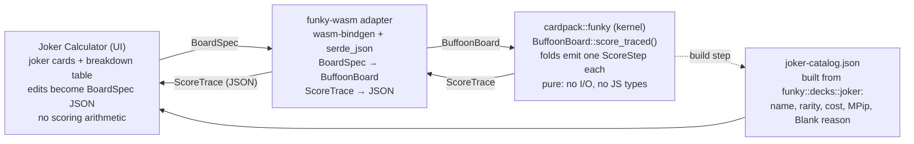

# Epic: cardpack.rs ↔ Balatro Joker Calculator integration

Oct 18, 2026 · @Christoph

## Summary

The Joker Calculator stops carrying its own scoring math and becomes a thin display over cardpack.rs's `funky` engine: every number in the breakdown table comes from `BuffoonBoard`, every joker card is a real `BuffoonCard` from `funky::decks::joker`, and the "updatable" fields edit the card's `MPip` before the board re-scores.

This is the first consumer of the solver seam EPIC-01 Story 8 built for exactly this purpose. The one thing the engine does not yet expose is the thing the calculator is for — a step-by-step trace of how chips and mult moved — so the keystone story adds a `ScoreTrace` to the fold pipeline. Everything else is packaging: a wasm boundary, a JSON shape the Design artifact can render, and a joker catalog with display names.

> **Proposed home:** `docs/EPIC-05_Joker_Calculator.md` in cardpack.rs, following the EPIC-01 format. The calculator's own repo holds only the front end.

## Current state

The two sides already agree on the model — chips × mult, base hand then played cards then held cards then jokers left-to-right — but only one of them is correct, and it is not the calculator.

|  | cardpack.rs `funky` (v0.11.1, `--features funky`) | Joker Calculator (Design artifact, today) |
| --- | --- | --- |
| Joker model | 120 `BuffoonCard` consts in `funky/decks/joker.rs`; effect is data (`enhancement: MPip`, \~69 variants); 8 stay `Blank` with a test-enforced reason | 28 hand-typed presets, each reduced to one of `+Chips` / `+Mult` / `×Mult` and a number |
| Scoring | `BuffoonBoard::score()` runs four phases via `fold_played_cards` / `fold_held_cards` / `fold_jokers`; each item resolves to a `ScoreOp` and `ScoreOp::apply` folds it | JS in the artboard: base → card chips → jokers; no held-card phase, no editions, no retriggers |
| Conditions | Evaluated from the board (`joker_x_mult`, `builtin_joker_op` read `played`, `in_hand`, `jokers`, `deck`, money, discards, blind) | An "active" checkbox the user ticks by hand |
| Randomness | `score()` is the deterministic floor; `score_with_seed(u64)` rolls Lucky / Misprint | Not modelled |
| Mult arithmetic | `Score { chips: usize, mult: usize }`; `multi_mult(f32)` **ceils** to `usize` | Fractional mult kept (`×1.25` shows as 1.25) |
| Step-by-step trace | **None** — the folds return only the final `Score` | The whole point of the UI: a row per source with running chips, mult, score |
| wasm | Compiles on `wasm32-unknown-unknown` for every feature combo ([docs/wasm.md](https://github.com/ImperialBower/cardpack.rs/blob/main/docs/wasm.md)); `wasm-bindgen-test` is already a dev-dependency; no bindings crate yet | Browser-only; no way to call Rust |
| Display names | Jokers are identified by const name and `Pip` index/symbol; no `fn name()` on `BuffoonCard` | Hard-coded English names |

Sources: [cardpack.rs](https://github.com/ImperialBower/cardpack.rs) — `src/funky/types/{board,score,effect,mpip,buffoon_card}.rs`, `docs/EPIC-01_Funky.md` (Story 8 "solver enablement"), `docs/EPIC-01a_Joker_Wiring_Backlog.md`, `.okf/architecture/funky-engine.md`.

## Goals and non-goals

**Goals**

- One source of truth: a number shown in the calculator is a number `funky` produced. The JS keeps no scoring arithmetic.
- Every breakdown row is explainable: it names the card, the `MPip` that fired, the `ScoreOp` it produced, and the running `Score` after it.
- Editable effects stay inside the type system: a user edit becomes a `BuffoonCard` with a changed `enhancement` (or `edition`), not an override applied after the fact.
- Conditions resolve from the board, not a checkbox: the calculator shows *why* Jolly Joker did or did not fire because the kernel reports it.
- The kernel stays pure: no DOM, no JS types, no calculator-specific code in `src/funky/`. The boundary is a separate crate (`funky-wasm` or similar) in the domain-kernel sense — a delivery adapter.
- Parity test: the kernel trace and the rendered table agree on every golden board.

**Non-goals**

- Playing Balatro. No shop, no antes, no run loop in the calculator; `BuffoonBoard` already has them and the calculator ignores them.
- Pixel-accurate joker art. The simplified card stays simplified.
- Modded jokers (`MPip::Custom` / `EffectRegistry`) in v1 — the seam exists; wiring it into the UI is a follow-on.
- Filling the 8 `Blank` jokers. They render as "not modelled" with their stated reason.

## Architecture

Three layers, one direction of truth: the UI describes a board, the kernel scores it and says how, the adapter only translates.



*Figure: integration architecture — 3 layers, 1 generated file (also in `docs/architecture.svg`).*

The UI never computes; it sends a `BoardSpec` and renders the `ScoreTrace` that comes back. The joker catalog is generated from the kernel's own joker constants so the picker cannot drift from what the engine scores.

**The two new kernel types** (in `src/funky/types/trace.rs`, behind `funky`):

```rust
pub struct ScoreStep {
    pub phase: Phase,            // Base, Played, Held, Joker
    pub source: StepSource,      // HandType, Card(BuffoonCard), Joker(BuffoonCard, index)
    pub effect: MPip,            // what was consulted
    pub op: ScoreOp,             // what it produced (Nothing when a condition fails)
    pub fired: bool,             // op != Nothing
    pub after: Score,            // running score once applied
}

pub struct ScoreTrace {
    pub hand_type: HandType,
    pub steps: Vec<ScoreStep>,
    pub total: Score,
}
```

`fold_played_cards`, `fold_held_cards` and `fold_jokers` already resolve each item to one `ScoreOp` and apply it — the trace is a sink those folds push into, so `score()` becomes `score_traced().total` and no scoring logic moves. A failed condition is a step with `op: Nothing, fired: false`, which is exactly the "skipped" row the calculator shows today.

**The boundary** (`funky-wasm`, a new crate in the workspace or a sibling repo):

- `score(spec_json: &str) -> String` — `BoardSpec` in, `ScoreTrace` out, both `serde`.
- `catalog() -> String` — the generated joker catalog.
- `BoardSpec` names jokers by their const identifier (`"JOLLY_JOKER"`) plus an optional `enhancement` override as an `MPip` and an optional `edition`; played and held cards as rank/suit pairs. Hand levels optional, default 1.
- No `BuffoonBoard` field is exposed raw. The adapter is the only place `wasm_bindgen` or `serde_json` appear.

This follows the domain-kernel split already used in the repo (`audit-2026-07-18-domain-kernel.md`): kernel pure, adapter owns the format.

## Stories

Ordered so each milestone ships something usable on its own. Story 1 is the keystone; nothing downstream can be honest without it.

### Milestone A — the kernel can explain itself (cardpack.rs)

**Story 1: `ScoreTrace` in the fold pipeline**

- [ ] Add `src/funky/types/trace.rs` with `ScoreStep`, `ScoreTrace`, `Phase`, `StepSource` (all `Clone + Debug + Serialize + Deserialize`, consistent with the rest of `funky/types`)
- [ ] Thread an `Option<&mut ScoreTrace>` sink through `fold_played_cards`, `fold_held_cards`, `fold_jokers` (same pattern as the existing `Option<&mut R>` RNG parameter)
- [ ] Phase 1 pushes one `Base` step carrying the `HandType` and level; retriggers push one step per trigger with a `retrigger: u8` ordinal
- [ ] `BuffoonBoard::score_traced()`, `score_traced_with_seed(u64)`, `score_traced_with_registry(&EffectRegistry)` — same trio as today's `score*`
- [ ] Invariant test: for every golden board, `score_traced().total == score()` and `steps.last().after == total`
- [ ] Invariant test: folding the steps' ops from the base `Score` reproduces each `after`
- [ ] `examples/buffoon.rs` prints the trace instead of (or alongside) the four phase totals

*Acceptance:* a Flush with Joker + Droll Joker + Crafty Joker + Cavendish yields a trace whose joker rows read `+4 Mult`, `+10 Mult`, `+80 Chips`, `×3 Mult` in that order, and a Pair with Droll Joker yields a `fired: false` row for it.

**Story 2: joker catalog with display names**

- [ ] A `JokerInfo { ident, name, rarity, cost, enhancement, blank_reason }` accessor over `funky::decks::joker` (names from the existing i18n resources where present, else the const name title-cased)
- [ ] `Deck::jokers()` or equivalent returns all 120 in a stable order
- [ ] Test: every joker const appears exactly once; the 8 `BLANK_WITH_REASON` entries carry a non-empty reason

**Story 3: `BoardSpec` — a serde-friendly way to build a `BuffoonBoard`**

- [ ] `BoardSpec { hand_levels, played, held, jokers: Vec<JokerSpec>, money, discards_left, hands_left, blind }` with every field optional and defaulted
- [ ] `JokerSpec { ident, enhancement: Option<MPip>, edition: Option<Edition>, debuffed: bool }` — the override is the "updatable effect"
- [ ] `TryFrom<BoardSpec> for BuffoonBoard` with a typed error naming the bad field (unknown ident, 6 jokers in 5 slots, played > 5 cards)
- [ ] Round-trip test: `BoardSpec` → board → trace → JSON → parse, for the golden boards

*Milestone A done when:* `cargo test --features funky` is green and `cargo run --example buffoon --features funky` prints a trace.

### Milestone B — the boundary (new crate `funky-wasm`)

**Story 4: wasm adapter**

- [ ] New crate depending on `cardpack = { default-features = false, features = ["funky"] }` plus `wasm-bindgen`, `serde-wasm-bindgen` or `serde_json`
- [ ] `.cargo/config.toml` with the `getrandom_backend="wasm_js"` cfg from `docs/wasm.md`
- [ ] Exports: `score(spec: &str) -> Result<String, JsError>`, `catalog() -> String`, `version() -> String`
- [ ] `wasm-bindgen-test` runs the golden boards in a headless browser in CI (`wasm-pack test --headless --chrome`)
- [ ] Size budget recorded in the README after `wasm-opt -Oz`; `i18n` and `colored-display` off

**Story 5: golden fixtures shared across the boundary**

- [ ] `fixtures/golden/*.json`: 10–15 `BoardSpec` + expected `ScoreTrace` pairs, checked into cardpack.rs and consumed verbatim by both the Rust tests and the UI tests
- [ ] At least one fixture per `ScoreOp` variant, one with a failed condition, one with a retrigger, one with an edition, one with a `Blank` joker

### Milestone C — the calculator renders the kernel (Design artifact / web)

**Story 6: replace the JS math with the wasm call**

- [ ] Load `funky_wasm.js` + `.wasm`; on any edit, build a `BoardSpec` from UI state and call `score`
- [ ] Delete `HANDS`, `JOKERS`, and the step loop from the artboard; the breakdown table maps 1:1 onto `ScoreTrace.steps`
- [ ] Joker picker populated from `catalog()`; the card's note shows the real `MPip` and, for `Blank`, the reason
- [ ] The "active" checkbox becomes read-only `fired` state computed by the kernel; a manual override remains only as the `debuffed` flag
- [ ] Editing the value or effect type writes a `JokerSpec.enhancement` override and shows an "overridden" badge on the card

**Story 7: played and held cards**

- [ ] A hand editor (rank + suit per card, up to 5 played, up to 8 held) replaces the single "played card chips" number
- [ ] Hand type comes from the trace, not a dropdown; the dropdown becomes a hand-level editor per `HandType`

**Story 8: parity test**

- [ ] A browser test renders each golden fixture and asserts the table's cells equal the fixture's trace

### Milestone D — polish

- [ ] Seeded mode: a seed field switches to `score_traced_with_seed`; the trace marks rolled steps
- [ ] Edition picker (Foil / Holo / Poly) per joker, rendered as a corner mark on the simplified card
- [ ] Export: copy the current `BoardSpec` JSON; paste one to restore a board
- [ ] Custom effects: a `MPip::Custom(id)` entry whose `ScoreOp` the user types, routed through an `EffectRegistry` in the adapter

## Open questions and risks

1. **Mult precision.** `Score.mult` is `usize` and `multi_mult` ceils after each ×mult, so Hologram at ×1.25 on mult 4 gives 5, and two ×1.5 jokers round twice. The calculator currently keeps decimals. Which is the Balatro behaviour to match? If the kernel changes to a fractional mult, that is a breaking change to `Score` and belongs in its own story before Story 1 lands.
2. **Crate placement.** `funky-wasm` inside cardpack.rs as a workspace member (shares CI, versions lock-step) or a sibling repo (keeps the kernel's dependency tree untouched)? The domain-kernel audit argues for sibling; CI convenience argues for workspace.
3. **Where the calculator lives.** The Design artifact cannot load a `.wasm` from the canvas page today, so Milestone C needs a real web host (a static page in the repo, `examples/wasm.rs` style). The artboard stays as the design reference.
4. **`funky` requires `std`.** Fine on `wasm32-unknown-unknown`, but it rules out a `no_std` component later. Acceptable for this epic; note it if the WIT / component-model road is ever taken.
5. **Display names.** The i18n resources may not cover all 120 jokers. Fallback is the const name title-cased, which is wrong for a few ("Dna", "Oops All 6s"). A small override table is the likely fix.
6. **Trace size.** Retriggers on a 5-card hand with Hack + Sock and Buskin can produce 20+ steps; the table needs grouping by card (Story 7) so it stays readable.

**Risks:** scope creep toward a playable game (the board already has a shop; the calculator must keep saying no); silent drift between catalog and engine if Story 2 is hand-maintained instead of generated.

## Definition of done

- The breakdown table in the calculator is produced entirely from a `ScoreTrace` returned by `cardpack::funky` via `funky-wasm`; the artboard contains no scoring arithmetic.
- Every one of the 120 jokers can be placed in a slot; 112 score, 8 show their `Blank` reason.
- Editing a joker's effect or edition changes the trace through a `JokerSpec` override, visibly marked as an override.
- Conditions are reported by the kernel (`fired`), not toggled by the user.
- The golden fixtures pass in `cargo test --features funky`, in `wasm-bindgen-test`, and in the browser parity test.
- `docs/EPIC-05_Joker_Calculator.md` closes with a status table in the EPIC-01a style, and `CHANGELOG.md` lists `ScoreTrace`, `BoardSpec` and the catalog accessor under Added.
